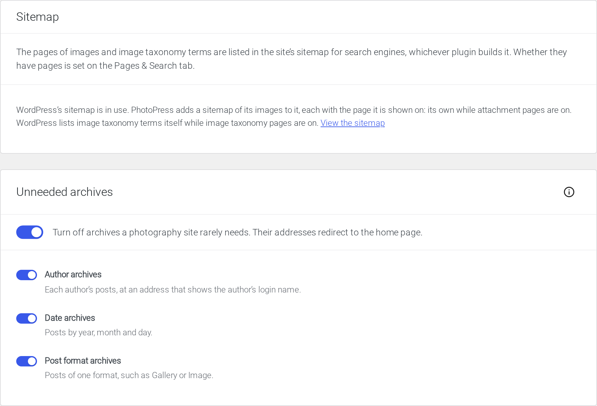

# PhotoPress: Making WordPress Work for Photographers

An integrated suite of image management and presentation features for WordPress that photographers can use to build beautiful photography centric websites.

## The Goal

The goal of PhotoPress is to make WordPress easy and compelling enough for photographers to use it as their primary web publishing platform instead of turning to other proprietary software/platforms. PhotoPress brings a variety of critical image management and presentation features together into a single, modern, and modular plugin. 

Our development motto is "do no harm" which means that we leverage the patterns outlined in WordPress Core and the Gutenberg editor as opposed to creating proprietary features that impede the overall usability of WordPress.

## Features

### Gallery Layouts

PhotoPress adds Masonry, Rows and Mosaic layouts to the WordPress Gallery block.

- Masonry arranges images in columns of a width you set. Each image keeps its own height.
- Rows arranges images in rows of a height you set. Each image keeps its own width.
- Mosaic fills each row to the gallery's width. Each image keeps its own proportions.
- Any gallery can open the full-screen slideshow when an image is clicked.
- Images load at the size the layout shows them, so pages load faster.
- An image deleted from the Media Library is removed from the galleries that show it.

Documentation: [Gallery Layouts](https://github.com/photopress-dev/photopress-plugin/wiki/Gallery-Layouts).

\
*The Masonry layout.*

\
*The Rows layout.*

\
*The Mosaic layout.*

\
*The Gallery settings tab.*

### Full-Screen Slideshow

- Clicking an image in a gallery opens it in a slideshow that fills the window.
- Visitors move through the images by clicking either half of the image, swiping or using the arrow keys.
- It can show a row of thumbnails, and the image's caption, title, description and a link to its page.

Documentation: [Full-Screen Slideshow](https://github.com/photopress-dev/photopress-plugin/wiki/Full-Screen-Slideshow).

\
*The full-screen slideshow, opened from a gallery.*

\
*The Slideshow settings tab.*

### Gallery Slideshow Block

- The Gallery Slideshow block shows a gallery on the same page as a slideshow, placed anywhere on the page.
- Clicking an image in the gallery shows it in the slideshow.
- It can show thumbnails, captions and autoplay, with a slide or fade between images.
- It can hide the gallery so only the slideshow shows.

Documentation: [Gallery Slideshow Block](https://github.com/photopress-dev/photopress-plugin/wiki/Gallery-Slideshow-Block).

\
*The Gallery Slideshow block, moved through by pressing either side.*

\
*Caption width on a desktop and on a phone.*

### Child Pages Gallery

- The Child Pages Gallery block shows the pages under a page as a gallery, each page as an image linked to it. It makes a good index of gallery pages.
- Updating PhotoPress converts the older Child Pages block to a Child Pages Gallery.

Documentation: [Child Pages Gallery](https://github.com/photopress-dev/photopress-plugin/wiki/Child-Pages-Gallery).

\
*A Child Pages Gallery in the Rows layout.*

### Metadata

- Image taxonomies: PhotoPress files each uploaded photo under its camera, lens, location, keywords and other metadata, with an archive page for each.
- You choose which metadata fields become taxonomies, including keyword hierarchies from Lightroom or Capture One and any IPTC field.
- The Image Metadata block shows an image's terms and exposure details on its page.
- Alt text and descriptions are written from each photo's metadata when it is uploaded.
- Licensing metadata is embedded in your image files and published as structured data on the pages that show them.
- Changes can be applied to the images already in the Media Library, in the background.

Documentation: [Image Taxonomies](https://github.com/photopress-dev/photopress-plugin/wiki/Image-Taxonomies), [Alt Text and Descriptions](https://github.com/photopress-dev/photopress-plugin/wiki/Alt-Text-and-Descriptions), [Licensing](https://github.com/photopress-dev/photopress-plugin/wiki/Licensing).

\
*The Image Metadata block on an image's page.*

\
*The image taxonomies on the Metadata tab.*

\
*A parent keyword given a taxonomy, and its images reprocessed.*

\
*The alt text and description templates.*

\
*The Licensing settings.*

### Image Templates

PhotoPress adds two templates to block themes: Image Archives and Image Pages. They need WordPress 6.7 or later. If the theme has its own template for these pages, the theme's is used.

- Image Archives shows a keyword's, camera's or other term's images in a gallery, with links to more pages.
- Image Pages shows an image with its caption, description, terms and exposure details.
- You can edit both templates in the Site Editor.
- The Taxonomy Gallery block shows the latest images, or the images of a chosen term, in any PhotoPress layout.

Documentation: [Image Templates and Blocks](https://github.com/photopress-dev/photopress-plugin/wiki/Image-Templates-and-Blocks), [Taxonomy Gallery](https://github.com/photopress-dev/photopress-plugin/wiki/Taxonomy-Gallery).

\
*A keyword's images in the Image Archives template.*

### Image and Taxonomy Pages

- Attachment pages: a switch that publishes, or stops publishing, a page for each image in the Media Library.
- Image taxonomy pages: a switch that publishes, or stops publishing, an archive page of images for each keyword, camera and other term.

Documentation: [Attachment and Taxonomy Pages](https://github.com/photopress-dev/photopress-plugin/wiki/Attachment-and-Taxonomy-Pages).

\
*The Pages & Search settings tab.*

### Search

- Images in search results: a switch that adds images to the site's search results, found by their titles, captions, alt text and terms.
- Block themes get an Image Search template that shows the images found in a gallery and lists the matching posts and pages below it.
- With [Relevanssi](https://wordpress.org/plugins/relevanssi/), PhotoPress has Relevanssi index images with their alt text and taxonomy terms.

Documentation: [Image Search](https://github.com/photopress-dev/photopress-plugin/wiki/Image-Search).

\
*Search results with images, in the Image Search template.*

### SEO

- PhotoPress adds image pages and image taxonomy archive pages to the site's sitemap, whether it is WordPress's own, [Jetpack](https://wordpress.org/plugins/jetpack/)'s or [Yoast SEO](https://wordpress.org/plugins/wordpress-seo/)'s.
- Unneeded archives: a switch that turns off author, date and post format archives, each on its own, redirecting them to the home page and leaving them out of the sitemap.

\
*The SEO settings tab.*

Documentation: [Sitemaps](https://github.com/photopress-dev/photopress-plugin/wiki/Sitemaps).

### Page Cache

On a site with a Varnish page cache and the [Proxy Cache Purge](https://wordpress.org/plugins/varnish-http-purge/) plugin, PhotoPress purges the cached pages that show an image, a gallery or an image taxonomy term when it changes.

Documentation: [Page Cache](https://github.com/photopress-dev/photopress-plugin/wiki/Page-Cache).

### Image Sizes

- You set the quality WordPress saves JPEG and WebP images at.
- You can turn off image sizes your site does not use, so WordPress stops making them.
- Save and regenerate updates the images already uploaded, in the background.

Documentation: [Image Sizes](https://github.com/photopress-dev/photopress-plugin/wiki/Image-Sizes).

\
*The Image Sizes settings tab.*

### Offload Media

These features need the [WP Offload Media](https://wordpress.org/plugins/amazon-s3-and-cloudfront/) plugin.

- You set how long browsers and the CDN cache offloaded images.
- A replaced image is cleared from CloudFront, so visitors see the new file.
- A replaced image's old files can be deleted from cloud storage.

Documentation: [Offload Media and CDN](https://github.com/photopress-dev/photopress-plugin/wiki/Offload-Media-and-CDN).

\
*The Offload Media settings tab.*

## Requirements

* WordPress 6.6
* PHP 7.0+

The plugin is coded to work on PHP 5.6+, but only 7.0+ is officially supported.

## Installation

The latest release of PhotoPress can be installed from the [WordPress plugin repository](https://wordpress.org/plugins/photopress/). 

## Development 

To contribute to PhotoPress you need to:

1. Clone the repository
2. Download and install [Composer](https://getcomposer.org/) for managing PHP dependencies.
3. Run `composer install`
4. Install [Node.js](https://nodejs.org/) 22 or later
5. Run `npm install`, then `npm run build` (or `npm start` to rebuild as you edit)

## Documentation

Documentation for PhotoPress is maintained on the [wiki](https://github.com/photopress-dev/photopress-plugin/wiki).  Please feel free to add to the wiki if you use the plugin.

## Copyright and License

This project is licensed under the [GNU GPL](http://www.gnu.org/licenses/old-licenses/gpl-2.0.html), version 2 or later.

2011&thinsp;&ndash;&thinsp;2020 &copy; [Peter Adams](http://peteradams.org).
