

# PhotoPress: Making WordPress Work for Photographers

An integrated suite of image management and presentation features for WordPress that photographers can use to build beautiful photography centric websites.

## The Goal

The goal of PhotoPress is to make WordPress easy and compelling enough for photographers to use it as their primary web publishing platform instead of turning to other proprietary software/platforms. PhotoPress brings a variety of critical image management and presentation features together into a single, modern, and modular plugin. 

Our development motto is "do no harm" which means that we leverage the patterns outlined in WordPress Core and the Gutenberg editor as opposed to creating proprietary features that impede the overall usability of WordPress.

## Features

### Gallery Layouts

Masonry, Rows and Mosaic layouts for the WordPress Gallery block, as block variations:

- Masonry: columns of a width you set, each image at its own height
- Rows: rows of a height you set, each image at its own width
- Mosaic: rows that fill the gallery's width, each image at its own proportions
- They look the same in the editor as on the site
- Open the full-screen slideshow when an image is clicked
- Hide captions option
- An image deleted from the Media Library is taken out of the galleries that show it
- A Gallery settings tab with a switch for each layout and for removing deleted images, all on by default

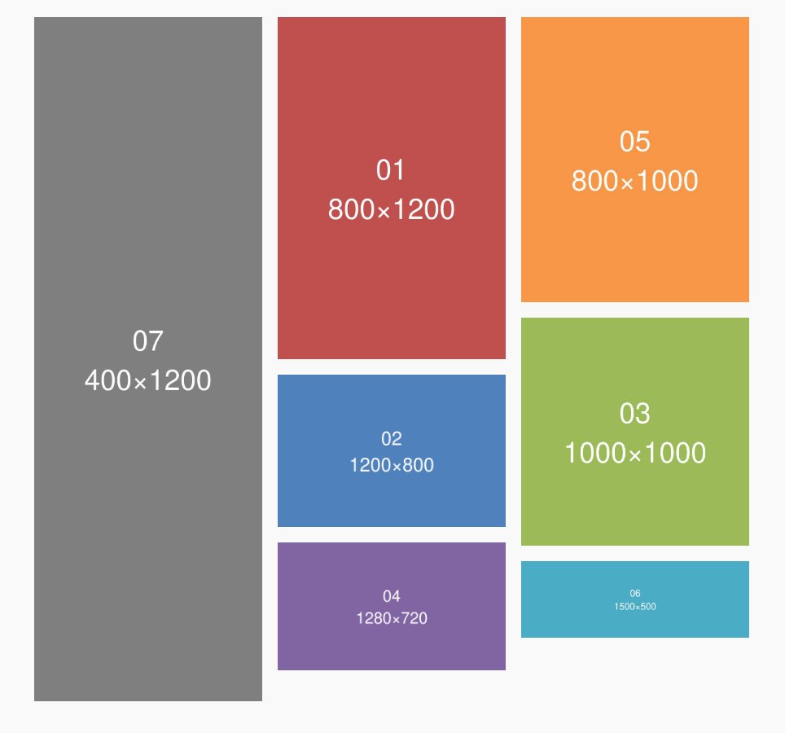

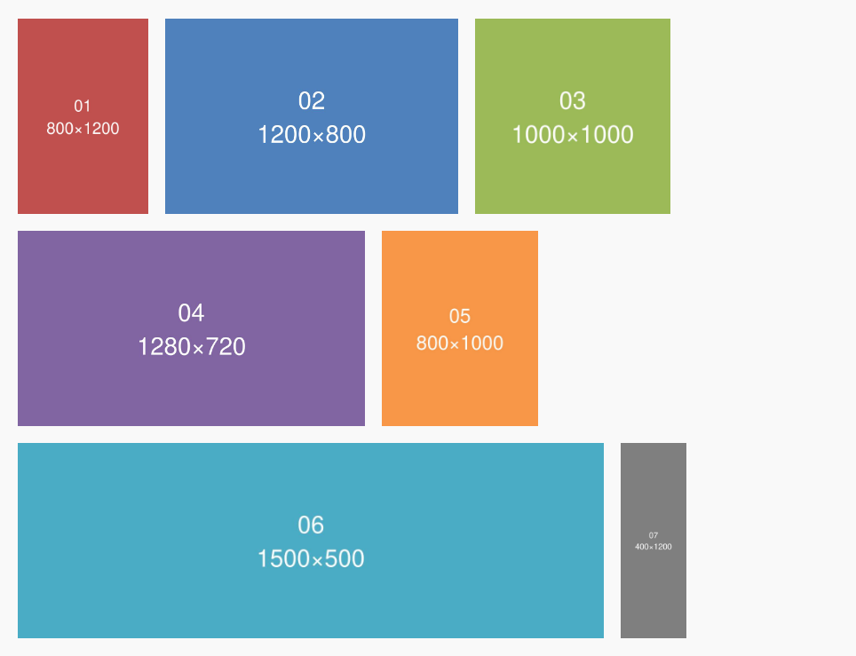

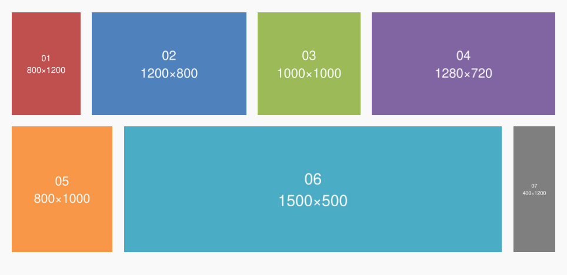

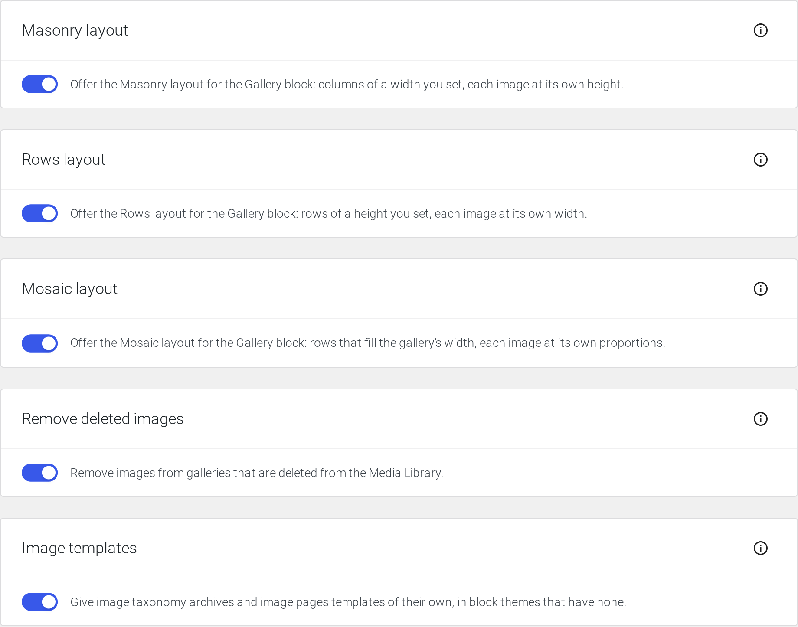

### Full-Screen Slideshow

- Opens over the whole window on the image that was clicked
- Click the right half for the next image, the left half for the previous one; the arrow keys work too
- Thumbnail navigation option, with adjustable height
- Configurable caption display (image title, caption and/or description, and a link to the attachment page)
- Caption box below or to the right of the image, with adjustable padding

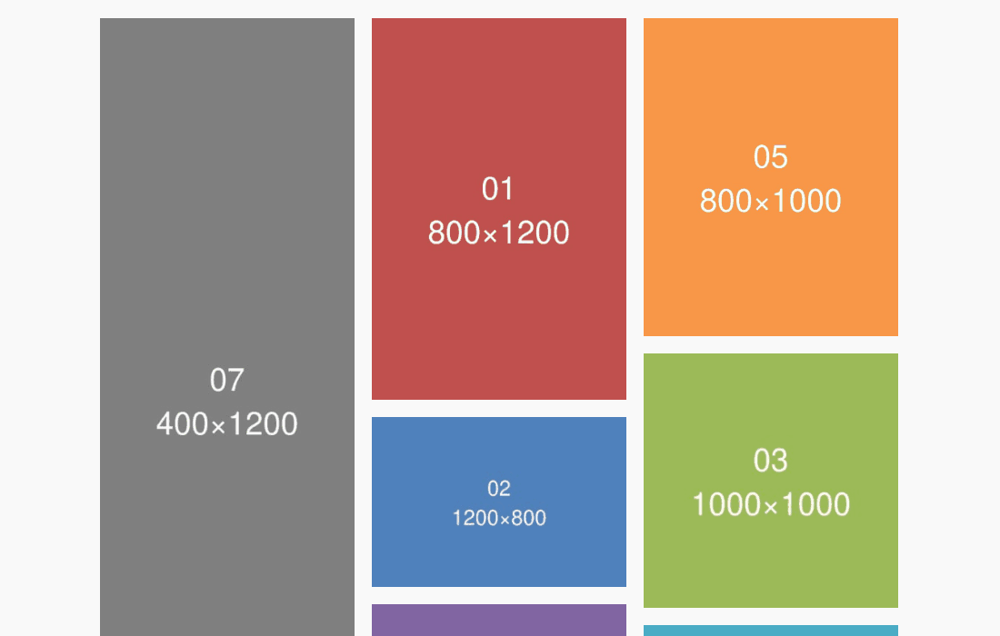

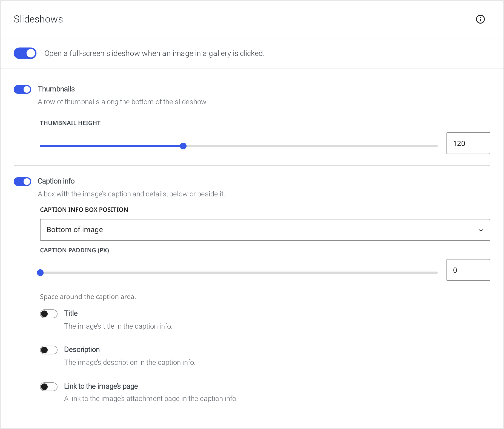

### Gallery Slideshow Block

- A slideshow of a gallery on the same page, placed anywhere on the page
- Clicking an image in the gallery shows it in the slideshow
- Press the right side of the slideshow for the next image, the left side for the previous one
- Slide or fade transitions, and autoplay
- Fits the window's height, less an offset you set
- Captions below, left or right of the image, with adjustable padding
- Caption max width, a share of the slideshow's width (75% by default) that keeps the full width on phones
- Option to hide the gallery and show only the slideshow
- Works with dynamic galleries (WordPress 7.1)

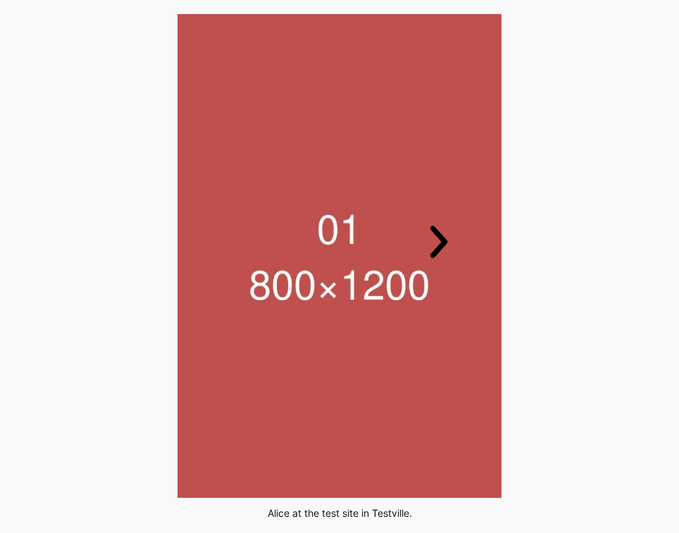

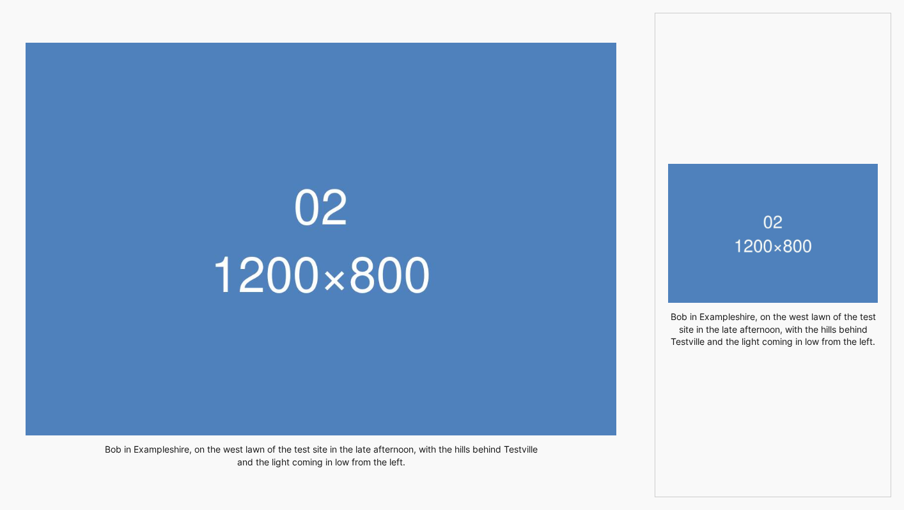

### Child Pages Block

- Dynamic Gutenberg Block
- Create a gallery of child pages, from their featured images (useful as an index of gallery pages)

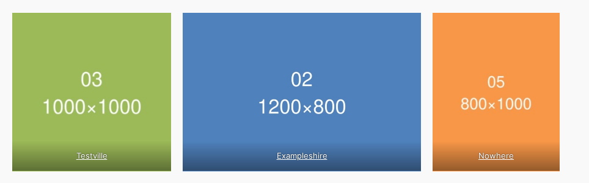

### Metadata

- Image taxonomies filled from each photo's embedded EXIF, IPTC and XMP metadata on upload, each with its own archive pages
- Standard Metadata: camera, lens, city, state, country and keywords, read from wherever cameras and photo software record them, with camera names cleaned up and keyword hierarchies kept as nested terms. Each can be renamed or turned off
- Hierarchical Keyword Metadata: keywords under a parent keyword (Genre › Portraiture in Lightroom or Capture One, or genre: Portraiture) go to the parent keyword's own taxonomy, each level nested under the one above
- The parent keywords found in your photos that have no taxonomy are listed, each with a button to add one
- Custom Metadata: any other metadata field as a taxonomy, chosen from a list of IPTC fields, each with what it holds and where photo software shows it
- Adding or changing a taxonomy offers to reprocess just the images it affects, in the background, with the progress on the settings page
- A taxonomy can be for the admin only: its terms are kept and shown in the Media Library, with no archive pages on the site
- Image Metadata block: an image's terms, such as keywords, people, places and camera, and its exposure details from the file (aperture, shutter speed, ISO, focal length, date taken), in the order you choose
- The Display Taxonomies and Display Image Exif widgets, for classic widget areas; in the block widgets editor, placed ones transform into the Image Metadata block
- Alt text from the Alt Text (Accessibility) written in the file by Lightroom Classic or Photoshop, or from a template of words and metadata fields
- Image descriptions from a template of words and metadata fields
- Licensing metadata (Licensor, Licensor URL, Web Statement of Rights): embedded into image files on upload, or into every image already uploaded, and added as structured data (JSON-LD) to the pages that show them, with any theme
- Save and reprocess all images: applies a new template or licensing to the images already uploaded, in the background

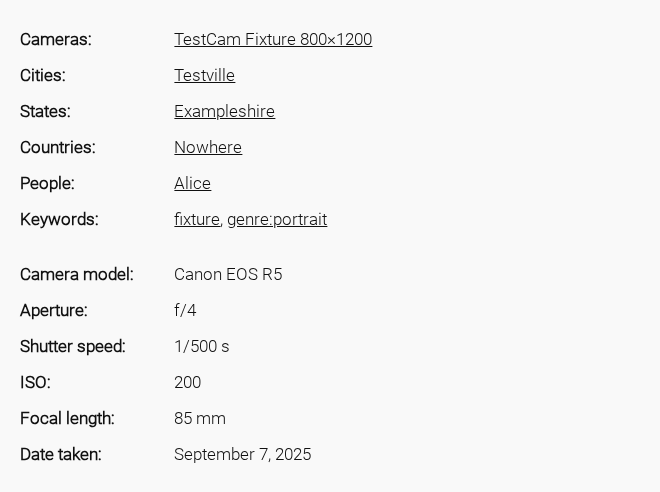

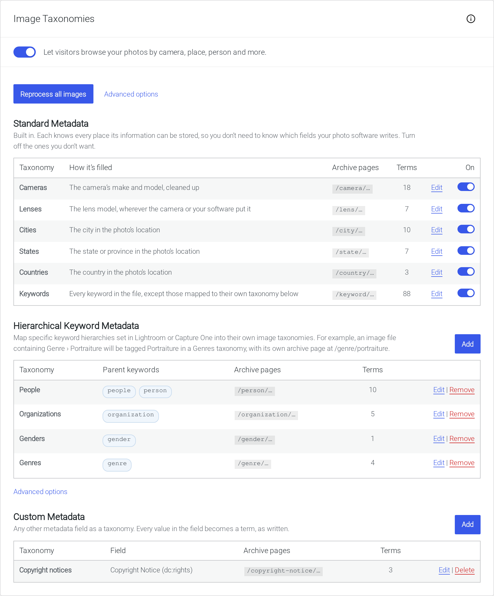

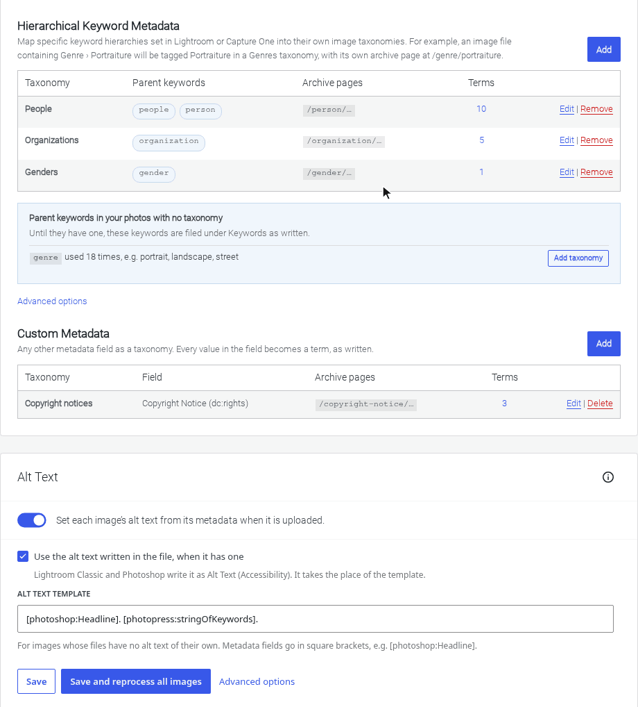

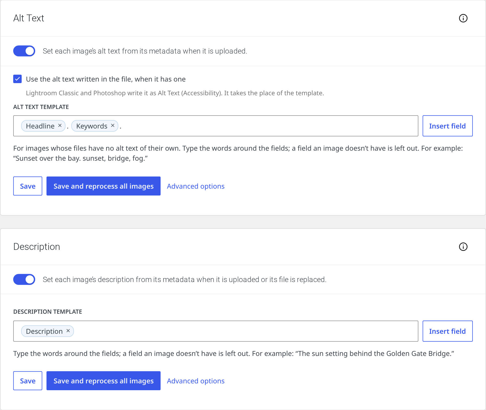

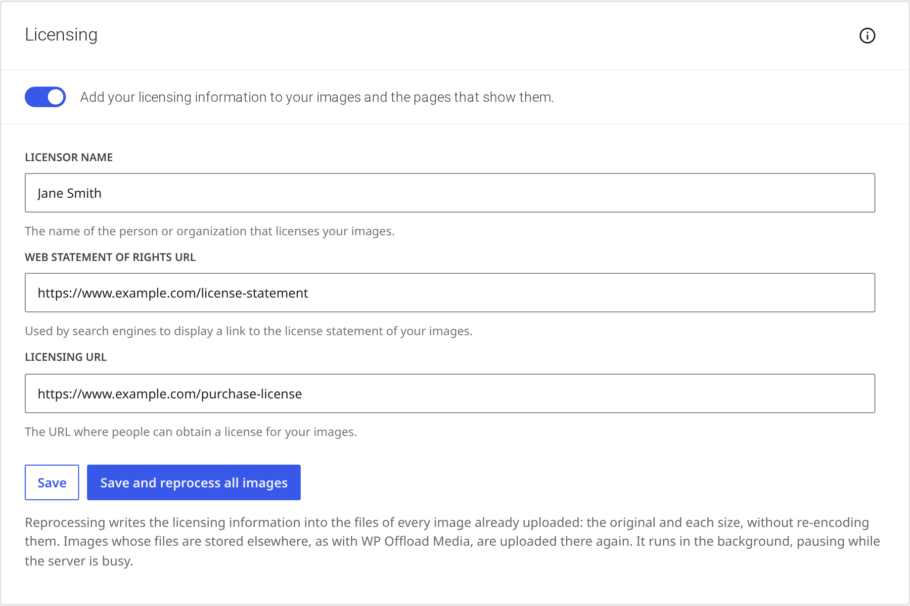

### Image Templates

For block themes that have no templates of their own for them (WordPress 6.7 or later):

- Image archives: a keyword's, a camera's or any image taxonomy's archive page shows its images in the Masonry layout, with links to more pages
- Image pages: the image, its caption and description, its taxonomy terms and its exposure details
- Both are edited in the Site Editor, like the theme's own templates, and each is there while its kind of page is on in the Pages & Search tab
- Taxonomy Gallery, a Gallery block variation in any PhotoPress layout: on an image archive template, the archive's images; anywhere else, the latest images or those of a keyword, camera or other term. And the Attachment Image block
- An archive of an image taxonomy looks for a taxonomy-attachment template, as themes built on the Frame framework do

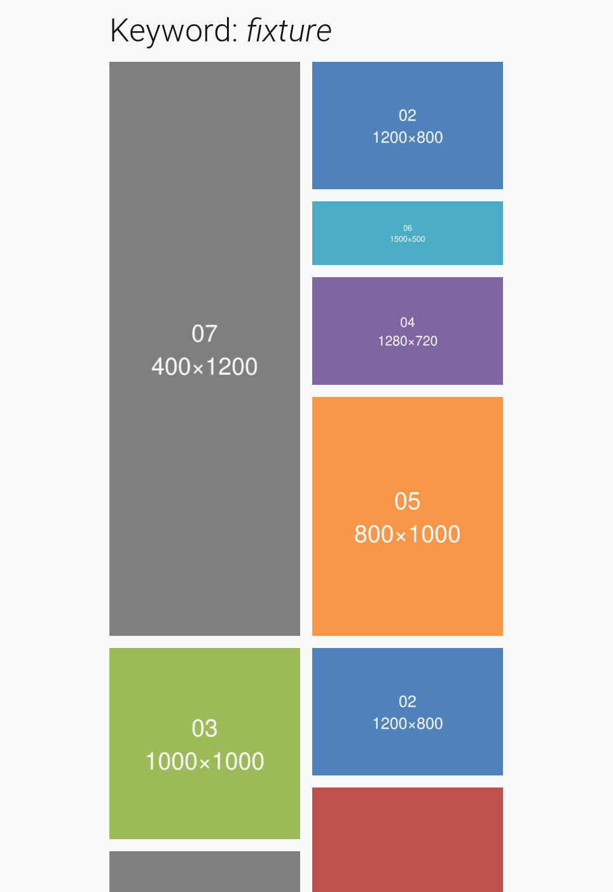

### Pages & Search

- Attachment pages switch: each image has a page of its own, or its page address and links to it go to the image file (WordPress's own setting)
- Image taxonomy pages switch: each keyword, camera or other term has an archive page of its images, or none, with the terms still shown on image pages, unlinked
- Both on by default; while each is on, block themes get PhotoPress's template for those pages
- Images in search results switch (off by default): visitors' searches find images by their titles, captions, alt text and terms, with posts and pages too unless turned off. Block themes get an Image Search template of blocks, to order as you like: the search box, a Search Summary (the terms and the number of images found), the images in a Taxonomy Gallery in rows with each one's file name and title under it, with numbered pages, and the posts and pages found in a Search Posts block
- With Relevanssi, PhotoPress has it index images, their alt text and the image taxonomies (its settings show the same), keeps an image's entry current as its terms change or are renamed, and adds existing images to its index in the background
- Page cache and search index: whether Proxy Cache Purge and Relevanssi are active, installed or not installed, as the Offload Media tab shows WP Offload Media, and how many images Relevanssi's index has, with a Re-index all images button. With Proxy Cache Purge, which clears a post's pages when it is saved but not an image's or a term's, PhotoPress clears an image's page when the image is edited or deleted or its terms change (while attachment pages are on), and every page of a term's archive when its images change or the term is renamed (while image taxonomy pages are on)

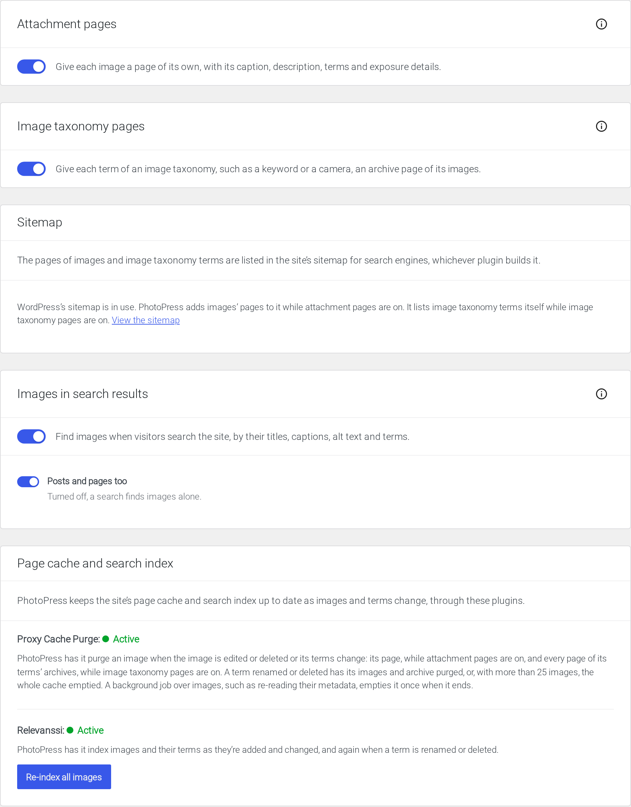

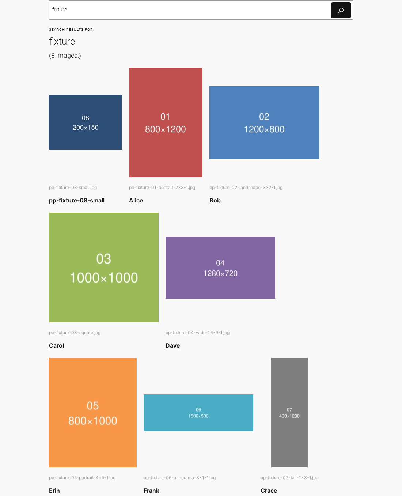

### Image Sizes

- The quality JPEG and WebP sizes are saved at, 92 by default (WordPress's own is 82)
- Every image size registered by WordPress, the theme and plugins, with a switch to stop making the ones nothing uses
- Save and regenerate: makes again only what each image needs, in the background, a few images at a time and waiting while the server is busy

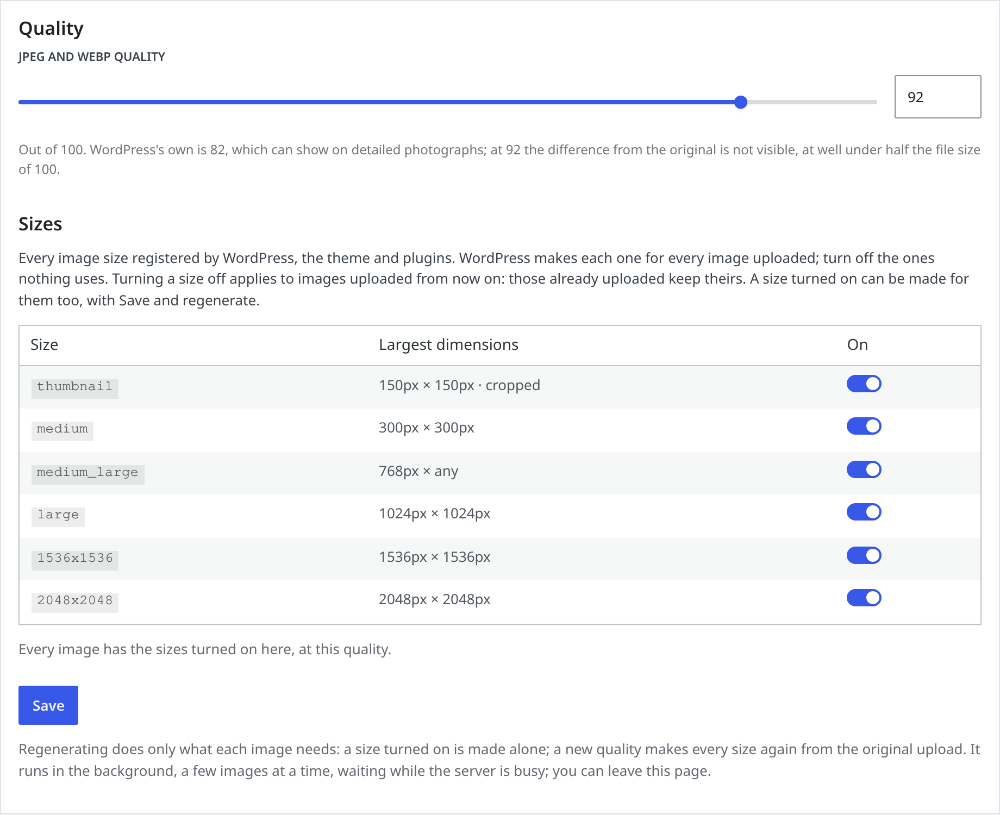

### Offload Media

With [WP Offload Media](https://wordpress.org/plugins/amazon-s3-and-cloudfront/) installed, the Offload Media settings tab shows:

- Whether Offload Media is active, and where images are stored and served from
- How long browsers and the CDN cache offloaded images, 1 day by default
- A replaced image cleared from CloudFront a few seconds later, so the new one shows, and a button to clear the whole CDN
- An option to delete a replaced image's old files from cloud storage

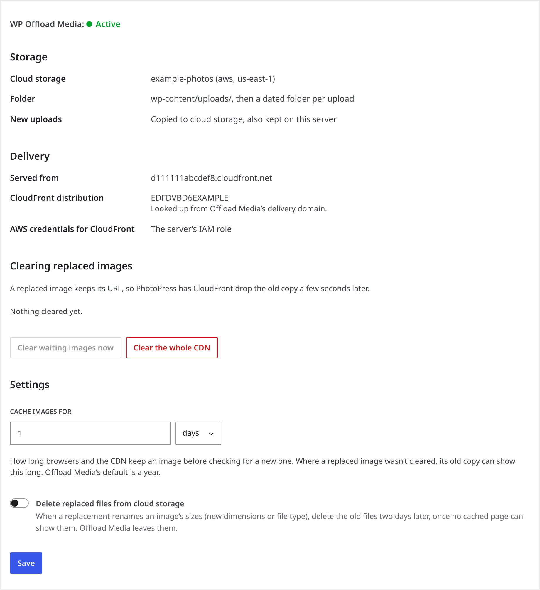

## Requirements

* WordPress 6.6
* PHP 7.0+

The plugin is coded to work on PHP 5.6+, but only 7.0+ is officially supported.

## Installation

The latest release of PhotoPress can be installed from the [WordPress plugin repository](https://wordpress.org/plugins/photopress/). 

## Development 

To contribute to PhotoPress you need to:

1. Clone the repository
2. Download and install [Composer](https://getcomposer.org/) for managing PHP dependencies.
3. Run `composer install`
4. Install [Node.js](https://nodejs.org/) 22 or later
5. Run `npm install`, then `npm run build` (or `npm start` to rebuild as you edit)

## Documentation

Documentation for PhotoPress is maintained on the [wiki](https://github.com/photopress-dev/photopress-plugin/wiki).  Please feel free to add to the wiki if you use the plugin.

## Copyright and License

This project is licensed under the [GNU GPL](http://www.gnu.org/licenses/old-licenses/gpl-2.0.html), version 2 or later.

2011&thinsp;&ndash;&thinsp;2020 &copy; [Peter Adams](http://peteradams.org).
